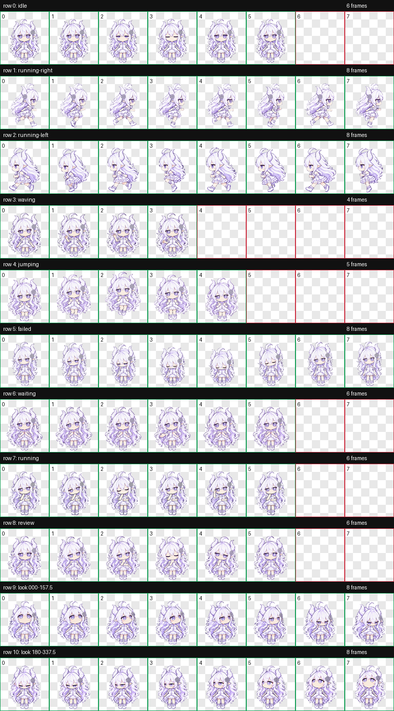

# GPT娘 · ChatGPT Pet

白发紫瞳的小龙娘，安静陪你写代码、思考和检查成果。

本项目保存个人自设「GPT娘」的 ChatGPT Work Pet v2 动画和本地展示程序。角色参考 [T7moris/GPT-Niang](https://github.com/T7moris/GPT-Niang)。

## 下载与查看

- 下载仓库内的 `gpt-niang-pet-v1.0.0.zip`，解压后打开 `index.html`，即可离线查看全部动作与朝向。
- `spritesheet.png` 是保持原始字节的透明动画图，供兼容 Pet v2 的工具使用。
- `pet.json` 记录帧位置、动作和朝向；这是资源元数据，不含账户凭据，也不会自动绑定到其他账户。
- 压缩包还包含全部 73 张独立 PNG 帧、逐动作 GIF、MP4 预览、校验报告和 SHA-256 清单。

当前打包的是动画与展示程序。其他客户端的安装和导入方式取决于其支持的格式。

## 动画规格

透明 PNG，1536 × 2288 像素，8 列 × 11 行，每格 192 × 208 像素。共 73 个有效帧、15 个透明空格。行号和列号从 0 开始。

| 行 | 状态 | 帧数 | 含义 |
| --- | --- | ---: | --- |
| 0 | idle | 6 | 待机 |
| 1 | running-right | 8 | 向右移动 |
| 2 | running-left | 8 | 向左移动 |
| 3 | waving | 4 | 挥手 |
| 4 | jumping | 5 | 跳跃 |
| 5 | failed | 8 | 失败反应 |
| 6 | waiting | 6 | 等待输入或确认 |
| 7 | running | 6 | 思考、处理任务 |
| 8 | review | 6 | 检查成果 |
| 9 | look | 8 | 0° 至 157.5° |
| 10 | look | 8 | 180° 至 337.5° |

朝向采用屏幕坐标：0° 向上、90° 向右、180° 向下、270° 向左，顺时针每 22.5° 一格。预览播放速度是展示设置，不代表客户端的固定播放速度。

## 校验与来源

2026-10-29 导出，原始动画图通过 ChatGPT Pets 的结构校验，结果见 `validation.json`。本次只导出和拆帧，没有重新绘制或替换已使用的 Pet。

`SHA256SUMS.txt` 可用于核对解压后各文件的字节完整性。

本项目用于非商业的个人 Pet 展示。保留 `CHARACTER-NOTICE.txt` 和 `SOURCE-NOTICE.md`。上游代码的 MIT License 不覆盖角色与图片；本仓库也不授予角色、第三方参考图或商标的额外权利。有关素材的后续使用以原声明及相应权利人的许可为准。
